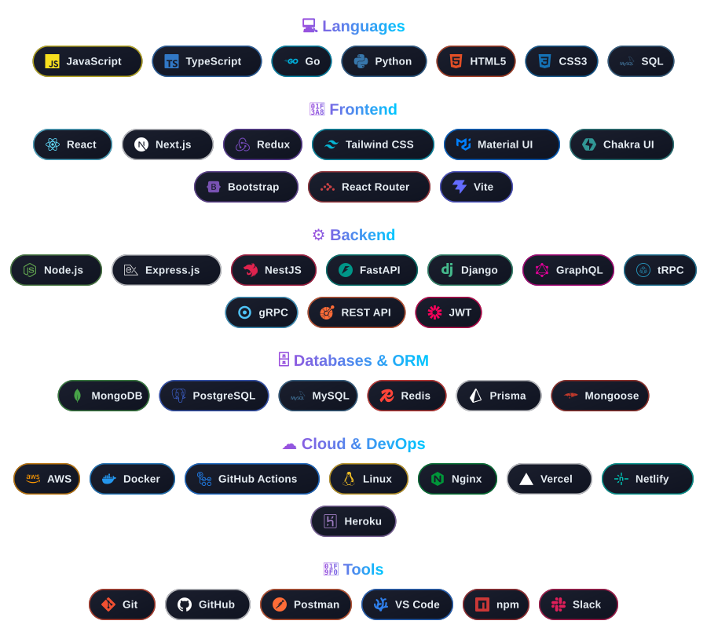

<!----------------------------------- Banner Section ------------------------------------>

<!----------------------------------- Hero Section ------------------------------------>
<h1 align="center">
  Hi  I'm Shikkandar
</h1>

  

  
  
  
  

  

 

<!----------------------------------- About Section ------------------------------------>

  

### 👨‍💻 Who am I?

Results-driven **Senior Software Engineer** and **Product Lead** with hands-on expertise in building **scalable backend architectures** and **enterprise automation systems** using **Golang** and **Python**.

Currently leading an **engineering team at HCL GUVI** to architect and scale **DORA** — an in-house CRM platform that automates end-to-end workflows across Pre-sales, Sales, Post-sales, Webinars and Quality teams.

I love translating complex business operations into reliable, high-performance technical solutions.

- 🚀 **Senior Software Engineer & Product Lead** | Working at [HCL GUVI](https://www.guvi.in)
- 👥 Leading an **engineering team**
- 🧩 Architecting **DORA CRM**: Pre-sales → Sales → Post-sales → Webinars → Quality
- 🐹 Scalable backends & automation with **Go** and **Python**
- 🏆 **Innovation Catalyst Award** (Apr – Sep 2026) for impactful product &amp; process innovations
- 📂 Check out my work → **[Projects](https://github.com/shikkandar?tab=repositories)**
- 📫 Reach me at **[mohammedshikkandar1@gmail.com](mailto:mohammedshikkandar1@gmail.com)**

 

 

<!----------------------------------- Connect Section ------------------------------------>

  

  &nbsp;
  &nbsp;
  

  

 

<!----------------------------------- Tech Stack Section ------------------------------------>

  

  

  

  &nbsp;&nbsp;
  &nbsp;&nbsp;
  &nbsp;&nbsp;
  &nbsp;&nbsp;
  

  

 

<!----------------------------------- GitHub Stats Section ------------------------------------>

  

  
  

  

  

